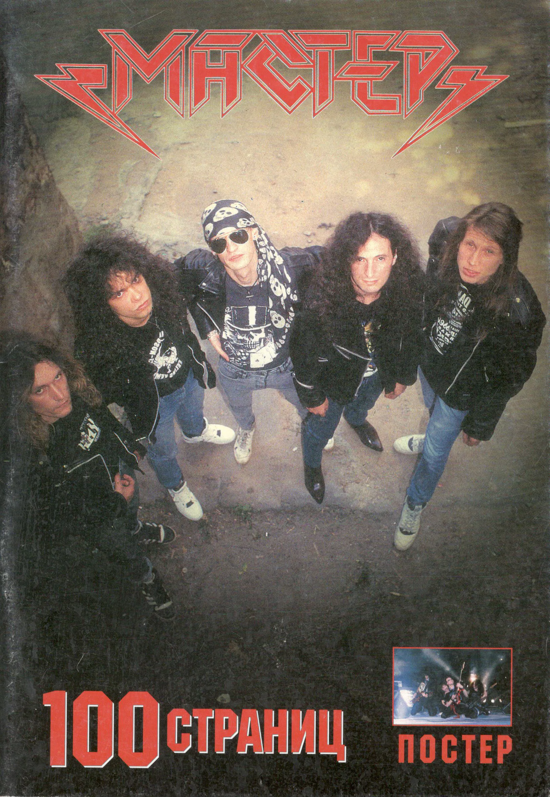

# Владимир Марочкин — «Мастер. 100 страниц»

Реконструкция и цифровое переиздание книги 2003 года об истории легендарной группы **«Мастер»**.

### 📖 О книге
Книга охватывает «золотой» период группы, начиная с ухода музыкантов из «Арии» в 1986 году, заканчивая началом 2000-х. В тексте подробно описаны записи альбомов, зарубежные гастроли и смены составов.

> *«Рок-энциклопедии датируют рождение группы «Мастер» осенью 1986 года... На самом деле всё началось гораздо раньше...»*

### 🛠 Особенности этого издания
- **Формат:** Свёрстано в современной системе [Typst](https://typst.app/).
- **Контент:** Полный текст книги, оригинальные фотографии и генеалогическое древо группы.
- **Качество:** Векторная вёрстка, оптимизированный размер PDF.

### 📥 Читать книгу
Самая актуальная версия PDF доступна по постоянной ссылке:
👉 **[Скачать PDF](https://github.com/vdistortion/master-metal-history/releases/latest/download/%D0%92%D0%BB%D0%B0%D0%B4%D0%B8%D0%BC%D0%B8%D1%80%20%D0%9C%D0%B0%D1%80%D0%BE%D1%87%D0%BA%D0%B8%D0%BD%20-%20%D0%9C%D0%B0%D1%81%D1%82%D0%B5%D1%80%20%282003%29.pdf)**

Страница актуального релиза: [GitHub Releases](https://github.com/vdistortion/master-metal-history/releases/latest)

### ⚖️ Правовой статус
- **Текст:** Принадлежит Владимиру Марочкину. Работа над цифровой версией велась с ведома автора; по его словам, книга ранее уже находилась в свободном доступе.
- **Оформление:** Данное цифровое издание является оригинальной вёрсткой (2026). Оригинальное издательство «НОТА-Р» (2003) ликвидировано в 2025 году.

### 🛠 Сборка из исходников
Если вы хотите собрать PDF самостоятельно:
1. Склонируйте репозиторий.
2. Запустите `./build.sh`.

Форматирование исходников выполняется отдельно командой `./format.sh`. Сборка
не изменяет `.typ`-файлы.
---
*Проект создан для сохранения истории отечественной тяжёлой музыки.*
